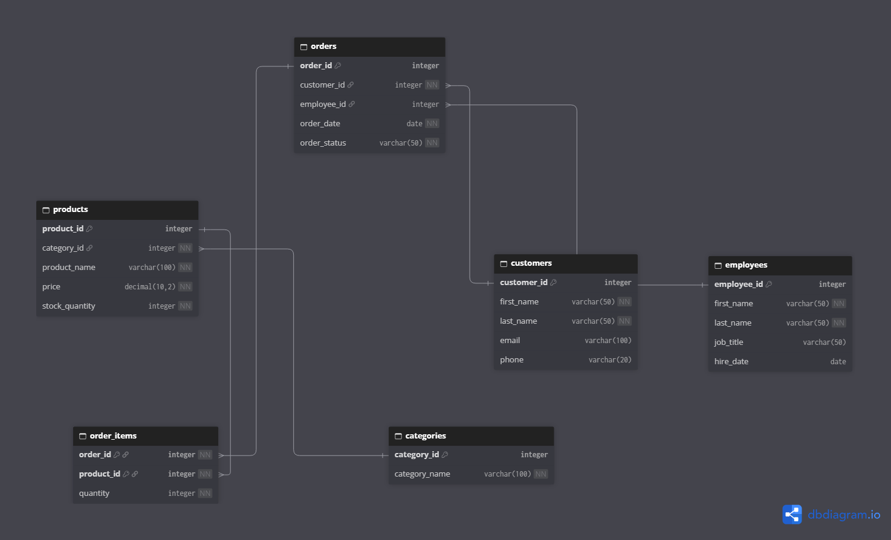

# Retail Store Database — Oracle SQL

## Overview
A retail store database built with Oracle SQL to manage
customers, employees, products, categories, orders, and order items.

## Files
- 01_schema.sql: Creates the tables, relationships, and constraints.
- 02_sample_data.sql: Inserts sample data and includes commented constraint tests.
- 03_analysis_queries.sql: Answers questions about inventory, customers, and orders.
- ERD.png: Shows the database structure and relationships.

## How to Run
Use an empty Oracle schema and run the scripts in this order:
1. 01_schema.sql
2. 02_sample_data.sql
3. 03_analysis_queries.sql

Run the scripts using Run Script in Oracle SQL Developer.

## Skills Demonstrated
- Relational database design
- Primary keys, foreign keys, and data constraints
- Filtering and sorting
- Aggregate functions, GROUP BY, and HAVING
- INNER JOIN and LEFT JOIN
- Subqueries and CASE expressions
- Date formatting and window functions

## Example Findings
- Camping Chair is the only product that has never appeared in an order.
- The sample data contains 20 orders, all placed in September 2026.

## Limitations
Product prices represent current prices. Historical sale prices
are not stored separately in order_items.

## Database Diagram
